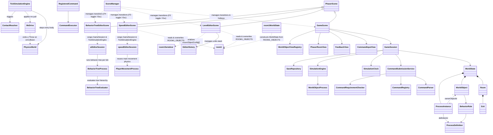

# Game Architecture

## Scope

Architecture specification for the command-driven RTS game and initial room (Vite, TypeScript, Phaser 4.2.1).

## Architectural Decisions

- **Phaser Scene**: `GameScene` owns the Phaser runtime scene, hosting in-view command input and feedback.
- **Viewport Scaling**: 1920×1080 scene with Phaser `FIT` scaling, centered with dark letterboxing; no browser fullscreen.
- **Authoritative Model**: Domain state is authoritative in TypeScript; Phaser objects strictly render domain state.
- **Virtual Hierarchy**: Virtual paths (`Room`, `WorldObject`) are domain metaphors; no OS filesystem or host shell access.
- **Command Whitelist**: Only registered virtual command executors run, one per line (no pipes, chaining, or scripting).
- **Execution & Simulation**: Commands run synchronously; autonomous behavior advances in fixed simulation ticks (input mode sets Time Scale, ADR 0005).
- **Process Model**: `ProcessDefinition` is reusable behavior; `ProcessInstance` tracks runtime state per world object.
- **Tick Engine**: `TickSimulationEngine` accumulates time into fixed 60 Hz (`1000/60` ms) ticks. A tick runs the processes (which apply Forces), `MvDrive`, the physics step, the processes' `afterPhysics` hooks, contacts, and `MvDrive.settle`, in stable object order.
- **Collision & Reach**: Domain AABB logic (`CollisionWorld`) handles overlap, reach, and targeting without Phaser physics (ADR 0007). Interaction ignores Discovery (ADR 0006).
- **Contacts**: Collider Tags on objects and a generic `ContactResolver` decide what a touch triggers (ADR 0008); whether two objects Collide is decided by the same tags (`collidesPhysically`).
- **Physics & Throws**: all movement is Forces integrated by `PhysicsWorld` (drag, speed cap, Collisions with restitution); `mv` only applies a pull through `MvDrive` (ADR 0010, superseding the flight rules of ADR 0009).
- **Persistence**: `SaveRepository` (`LocalStorageSaveRepository`) stores snapshots with domain state and command history.

## Runtime Responsibilities

### Phaser Scene

`GameScene` (1920×1080 reference space) mounts Room 1 domain state, session, room/object views, input, feedback, and outcome panels, forwarding Phaser's frame delta to `GameSession`. `createGame` boots with `GameScene`.

`PhaserCommandInputView` sits bottom-center. In Command Mode, it accepts printable ASCII, cursor editing, auto-wrapping, and history navigation; Enter submits. In Movement Mode, it is dimmed with a typing prompt hint. `PhaserRoomView` projects world objects to Phaser sprites (orienting characters horizontally based on `facing` via `flipX`, and rendering equipped items in local holder coordinates `WEAPON_HOLD_OFFSET = { x: 44, y: 38 }` mirrored with the holder's facing direction, translating equipped dagger position along the horizontal facing axis during attacks by `DAGGER_ATTACK_DISTANCE` [30 px] over `DAGGER_ATTACK_DURATION_MS` [200 ms]) and overhead labels (`?` for undiscovered objects, object name once revealed, and `hacker` for the player character; equipped items remain visible with label scale shrunk to `ITEM_LABEL_WIDTH_RATIO` [0.75] of item sprite width to avoid overlapping the character); `PhaserGameOutcomePanel` displays Game Over / Congratulations states.

### Input Modes

| Mode | Time Scale | Player Control | Combat & Actions |
|---|:---:|---|---|
| **Movement** | 1.00 | Arrows (responsive physics, turning left/right) | Space / Left-click: attack (auto-pickup on contact) |
| **Command** | 0.25 | Disabled (or latched direction) | Ignored |

- **Shell Entry & Exit**: Typing any alphabet key (`[a-zA-Z]`) while in Movement Mode directly enters Command Mode and begins typing the command. Pressing Escape in Command Mode immediately exits Command Mode and clears any unsubmitted command draft.
- **Submission**: Commands submitted with Enter execute and switch back to Movement Mode (unless `inputAfter` overrides).
- **Latched Movement**: Typing an alphabet while holding movement keys latches velocity until collision, room exit, or Escape/submission; latched keys are suppressed from typing input.
- **Prompt**: Displays active room path.

### Command Input Behavior

- **Tab Completion**: Tab on empty input completes `help`; otherwise completes registered commands, discovered room entries, and the player character's label (`hacker`). Argument positions (after command name and whitespace) complete room entries (including `hacker`) without command name collisions. Unique matches append a trailing space; ambiguous matches complete the common prefix.
- **Discovery Gate**: Undiscovered objects require discovery (`ls` or direct interaction) before autocomplete inclusion; the player character is always discovered.
- **History & Editing**: `Ctrl+Backspace` deletes previous word; `Up`/`Down` navigates command history (down past newest restores draft).

### Application Session & Command Pipeline

`GameSession` orchestrates `WorldState`, input mode, player actions, command execution, and simulation ticks.

Synchronous submission pipeline:
1. `VirtualCommandParser`: Parses raw input into command, options, arguments.
2. `RegisteredCommandRegistry`: Resolves command name against allow-list.
3. `CommandRequirementChecker`: Validates requirements against world state.
4. `CommandExecutor`: Synchronously updates domain state.
5. `CommandResult`: Emits object-attached or general feedback.

### World and Process Model

- `WorldState`: Root aggregate for rooms, world objects, active process instances, current room, simulation tick, outcome, and command history.
- `Room`: Enterable area owning exits.
- `WorldObject`: Domain entity with identity, room ID, metadata, behavior rules, and runtime state. Roles include `player`, `enemy` (hostile characters such as guards), `weapon`, and `object` (such as environmental world objects like `boulder`; its `BoulderProcess` has no behavior of its own, thrown flight is owned by the engine).
- `BehaviorRule`: Maps object condition to `ProcessDefinition`.
- `VirtualWorldPathResolver`: Resolves virtual command paths to room/object IDs (no host filesystem access).

### Simulation Time

`RealtimeSimulationClock` scales Phaser frame delta by active Time Scale (max 250 ms real delta clamped per frame). `TickSimulationEngine` accumulates game delta into fixed 60 Hz ticks. `GameSession.getRenderPosition` interpolates object positions between ticks for smooth visual rendering decoupled from tick rate. Each tick runs the object processes (they only apply Forces), then `MvDrive.drive`, the physics step, the `afterPhysics` hooks, contacts and `MvDrive.settle` (see Physics step).

### Combat and Collision

Characters start with 100 Health. Weapon definitions scale cooldowns with simulation time:

| Weapon | Damage | Cooldown | Reach | Notes |
|---|:---:|:---:|:---:|---|
| Unarmed | 10 | 0.5s | 5 px | Default when unarmed |
| Dagger | 35 | 0.5s | 10 px | Single-target |
| Guard | 20 | 1.0s | 5 px | Hostile guard attack |

Attacks damage nearest character within Reach (bounding-box gap). Items (including Dagger) are automatically picked up when within `PICKUP_REACH = 10` px; both actions mark undiscovered targets discovered. Hitboxes scale proportionally via `scaleX`/`scaleY` from base dimensions (`CHARACTER_SIZE` 110×160, `DAGGER_SIZE` 72×72, `BOULDER_SIZE` 120×120).

#### Collider Tags and Impact Damage

Each World Object carries `metadata.colliderTags` (typed in `domain/ColliderTag.ts`), set from `role` when the object is built by `createInitialWorldState` (`defaultColliderTags`): a `weapon` role gets `{ class: 'weapon', impactDamageRate: 0.05 }`, `player`/`enemy` get `{ class: 'character' }`, and `object` (the boulder) gets `{ class: 'obstacle' }`. The tags are not stored in `room1.ts` and no editor edits them.

`collidesPhysically(a, b)` (and `rolesCollide` for roles, used by the Level Editor) is the table of which tag classes push each other apart: Character–Character, Character–Obstacle, Obstacle–Obstacle and Weapon–Obstacle. A Weapon passes through Characters and other Weapons, so the Impact Damage trigger below still fires. Trigger rules and physical Collisions are separate: a touch can be both.

`simulation/ContactResolver.ts` visits every object in the current room that has `thrown` set, finds the other objects it overlaps (`CollisionWorld.gap === 0`), and runs the `ContactRule` registered for the pair of tag classes. The single rule, `weaponHitsCharacter`:
- Applies only while the weapon is in flight (`thrown` set); a held or resting dagger never hurts.
- Deals `impactDamageRate × |velocity|` (velocity in game-time px/s, so Time Scale does not change it) to each alive Character, at most once per Throw per Character (`thrown.hitIds`; zero-speed touches also use up the hit; a new `mv` resets `hitIds`). Health stays fractional and a Character is defeated at Health ≤ 0.
- Is a trigger: the weapon keeps flying, nothing else changes, and the Character is not marked discovered. The thrower is not excluded and there is no friendly-fire exemption.
- Thrown Characters and the boulder carry no weapon tag, so they hurt nobody. A Weapon whose Throw has ended (it hit an Obstacle) hurts nobody either.

After the rules run, `applyPlayerDefeat` (`domain/PlayerDefeat.ts`) sets `game-over` if the Player Character was defeated; the guard's attack uses the same function. `TickSimulationEngine` takes the resolver through its options; the Speed Editor passes `contactResolver: null`, so contacts are off there.

#### Physics step (`simulation/PhysicsWorld.ts`)

Every body of the current room (an object with `x/y/width/height`, alive, not a held Weapon) is moved only by Forces. Processes call `applyForce(obj, fx, fy)`, which adds to `forceX/forceY` in the object state; `PhysicsWorld.step` consumes and clears them each tick:

1. **integrate**: `v + F ÷ mass × dt` is capped at `max(max_velocity, the speed before the Force)`, then multiplied by `max(0, 1 − drag × dt)`. `max_velocity` only limits what a Force can add, so speed given by a Collision is kept. A body with no Force this tick and `|v| < min_velocity` is set to rest. A body with `frozen` set (an arriving Throw) is skipped for the tick.
2. **separate**: bodies that collide physically and already overlap are pushed apart along the shallowest axis; only one of each pair moves (the one with a Force or velocity, else the lighter one).
3. **move**: each body moves by `v × dt` through `resolveMovement` against the bodies it collides with and the room bounds (`Room.bounds`). Bounds clamp the position and zero the speed into the edge, with no bounce.
4. **collide**: each touching pair that is approaching exchanges motion with `resolveCollision` (`domain/CollisionResponse.ts`) and the `onCollision` listeners are called with `{ a, b, normal, closingSpeed }`.

A Collision exchanges motion along the line between the two box centres. The restitution is the product of both bodies' (`restitution`, default 0.5). A body at rest that would gain less than `min_collide_move_velocity` (50 px/s) counts as infinitely heavy and the mover bounces off it with `−e × v`. Tangential speed is unchanged. Walking bodies take part: a player or guard that runs into the boulder pushes it if the impact is fast enough, while leaning on it from standstill does not move it.

**Walking and pursuit** only apply Forces. `simulation/Drive.ts` has `accelerateToward(obj, targetVx, targetVy, maxAcceleration, tickMs)` (Force = mass × the velocity change that drag leaves at the target, limited to `maxAcceleration × dt`, so mass does not change walking speed), `steerToward`/`steerAway`, and `GUARD_ACCELERATION` (2500 px/s²). The player process (`walkingChange`) accelerates towards `input × maxSpeed` with `acceleration`/`turnaroundAcceleration`, brakes with `frictionAcceleration` without input, and leaves a speed beyond `maxSpeed` (a push) alone. Guards and behavior-tree actions steer at `speed` (times the node's multiplier) and slow down to stop at their reach; idle guards brake. A Thrown Character keeps its own walking or pursuit Force, so Forces simply add up.

The processes' `afterPhysics` hooks (run by `TickSimulationEngine` after the step) do what depends on the new positions: the player picks up weapons and detects the exit, and a held Weapon follows its holder.

#### Throw (`mv`)

`mv` stores `thrown: { targetX, targetY, targetObjectId, hitIds }` and leaves velocity alone (starts at rest; a re-`mv` keeps the current velocity and resets `hitIds`). `simulation/MvDrive.ts` then, per tick and per Thrown object (alive, in the current room):

- **drive** (before the physics step): tracks a moving target object's position; if the distance to the target centre is ≤ `max(speed × dt, ARRIVAL_RADIUS = 10 px)` the object is placed on the target and `frozen` for the tick (`thrown.arrived`), otherwise it applies a Force of `mass × mv_acceleration` towards the target, so objects of any mass speed up alike.
- **collision** (physics listener): the first Collision of a Thrown object ends its Throw: `thrown` is cleared, the speed is kept and no more Force is applied, so the physics step carries it on. Colliding with the target object itself marks it discovered; colliding with any other object does not. A Throw that would Collide first therefore never reaches its target.
- **settle** (after contacts): an arrived object gets `vx = vy = 0`, `thrown = null` and its target marked discovered. Contacts therefore see the speed the object arrived with.
- Weapons collide only with Obstacles, so a thrown Weapon flies through Characters (and can hurt them) but stops its Throw against the boulder.
- A held dagger has `thrown` cleared and its velocity zeroed by `DaggerPickupProcess`; it is re-picked up the tick after it is thrown if the player is unarmed and in reach, and a dagger in flight that comes within reach of an unarmed player is picked up in that tick's `afterPhysics` (expected behaviour).

Parameters: `mv_acceleration` 5000 px/s² (`commands/mvConstants.ts`, `GAME_MV_CONFIG`). Physics defaults (`simulation/physicsConstants.ts`, `GAME_PHYSICS_CONFIG`): `drag` 0.5 /s, `mass` 1, `max_velocity` 1000 px/s, `restitution` 0.5, `min_velocity` 5 px/s, `min_collide_move_velocity` 50 px/s. An object may set its own `drag`, `mass`, `max_velocity` and `restitution` at the top level of its state (also `RoomObjectConfig`); unset fields fall back to the defaults at use time (`domain/PhysicsAttr.ts`, `resolvePhysicsAttr`). Only `mass ≥ 0.001` is enforced; other values are unrestricted (a `max_velocity` or `mv_acceleration` of 0 leaves the object unable to arrive, and there is no flight timeout).

### Collisionbox & Collision Resolution

Every world object, weapons included, has a domain-owned `collisionBox` (`width`, `height`) and physical footprint; a Weapon's defaults to its scaled `DAGGER_SIZE` and `colliderWidth`/`colliderHeight` in `room1.ts` override it. Which pairs actually collide is decided by the Collider Tags (see above). A held Weapon and a defeated Character take no part in the physics.

`AabbCollisionWorld` provides `overlaps(a, b)`, `gap` and `resolveMovement(currentBox, targetBox, obstacles, bounds)`, which `PhysicsWorld` uses to guarantee that bodies that collide never overlap each other: movement is resolved axis-by-axis against the other bodies, sliding along edges. Processes no longer resolve movement themselves.
- In `LevelEditorScene`, each non-weapon world object displays a visual green collisionbox matching its physical dimensions. Non-weapon collisionboxes are directly editable via handle dragging (green handle at bottom-right of the collider box), inspector panel dimension controls (`box_w`, `box_h`), scale buttons (`BOX +` / `BOX -`), and hotkeys (`[` / `]`). Dragging, nudging, scaling, collider resizing, and spawning refuse positions where two objects that collide physically (`rolesCollide`) would overlap, so a Dagger can sit over a Guard but not over the boulder. Weapon collider boxes are not editable in the editor yet.
- In `room1.ts`, all starting world object positions are arranged without overlap of objects that collide.

### First Room Behavior

Room 1 initializes with Player Character (upper-left, named `hacker`), Dagger (lower-left), Boulder (environmental world object with role `object`), and Guards (hostile characters with role `enemy`, right). All World Object sprites are shown by default. Exiting right leads to Room 2:
- Undiscovered world objects display a `?` overhead label at the top of their sprite; the player character displays `hacker` and is never `?`. The player character's label (`hacker`) is tab-completable in command line autocompletion.
- `ls` discovers objects in the room and reveals their `?` labels to their respective names; direct player interaction (picking up an item or attacking a guard) also marks the target object discovered, while guard movement/pursuit and guard attacks do not discover the guard.
- `mv <label1> <label2>` throws `<label1>` towards `<label2>` (an object or room exit) as a Throw (see Throw: it accelerates from rest under `mv_acceleration`, drag and `max_velocity`, ends at its first Collision, and a thrown Weapon hurts Characters it touches), unequipping it if equipped. If `<label2>` does not exist in the room, it renames `<label1>` to `<label2>` and marks it discovered.
- `mv` Wildcard source: a `*` in `<label1>` (any run of characters, case-insensitive, any position, repeatable) is matched against the display names of every object in the current room (ignoring Discovery, player included). The typed command is not expanded; `<label2>` is always literal, so names may contain `*`. The target object is excluded from the matches (no same-object error); zero matches rejects with `Cannot find "<pattern>".`. With an existing target all matches are thrown and reported in one popup (`Threw a, b to target.`). With a non-existent target a single match is renamed to the plain target name, while two or more are renamed `<target>_0`, `<target>_1`, … (the counter skips names taken by non-source objects, exit labels or exit target room ids, and continues across sources).
- The player walks with Arrows (turning left or right horizontally when pressing Left or Right Arrow, flipping the sprite and equipped weapon offset in presentation), automatically picks up the Dagger (and any items) on contact/reach, and attacks with Space or left click. Equipped weapons track the holder position in domain state (`dagger.x = holder.x, dagger.y = holder.y`, translating `dagger.x` forward during attack animation) while `PhaserRoomView` handles local coordinate attachment, mirroring, and attack translation animation. Typing any alphabet key directly switches to Command Mode and begins entering a command.
- Guard pursues player when player enters room's right half; attacks within Reach.
- Player reaching 0 Health triggers `game-over`. Defeating guard stops pursuit. Reaching exit triggers `congratulations`.

### Persistence

`WorldStateCodec` converts between `WorldState` and `WorldStateSnapshot`. `SaveSnapshot` (`schemaVersion` 2; a save from an older schema reads as no save) bundles domain state and raw command history into `LocalStorageSaveRepository`, which holds exactly one Save Slot (default key `hack-game.save`; Speed and AI editor sessions use `hack-game.editor-save` so they never touch the game's slot).

#### Save API (`GameSession`)

| Method | Behavior |
|---|---|
| `saveCurrentState()` | Writes the current world to the Save Slot, replacing any prior record. |
| `hasSavedState()` | `true` only if the slot holds a readable snapshot with the current `schemaVersion`; corrupt JSON counts as no save (never throws). |
| `loadSavedState()` | Hydrates the snapshot over the live `WorldState` in place and returns `true`; returns `false` and changes nothing if there is no usable save. Restores positions, health, equipment, process instances, `simulationTick` and `commandHistory`; forces `outcome = 'playing'`, releases held keys and enters Movement Mode (unsent command drafts are dropped by the scene).|

**Nothing calls `saveCurrentState()` yet.** No Save Point is defined; to add one, call `session.saveCurrentState()` at the desired moment (e.g. in `GameScene` or a simulation process). Until then `hasSavedState()` is `false`, so the Game Over "LOAD SAVE" choice is disabled. A fresh page load always starts a new game; there is no "continue" entry point.

### Game Over Choices

When `outcome === 'game-over'`, `PhaserGameOutcomePanel` shows two buttons below the message: `RESTART` and `LOAD SAVE`. Selection state lives in `GameOverMenu` (Phaser-free, unit-tested).

- **Keyboard**: Left/Right moves the selection (wraps, skips disabled), Enter confirms. While the menu is active `GameScene.handleKeyDown` swallows all other keys, so letters cannot enter Command Mode; if the player dies while in Command Mode the scene returns to Movement Mode and clears the draft.
- **Mouse**: hovering selects an enabled button, clicking confirms it.
- **Default selection**: `RESTART`. `LOAD SAVE` is greyed out and unselectable unless `hasSavedState()` was `true` at the moment of death.
- **Effect**: both choices call `scene.restart({ resumeFromSave })`. `RESTART` rebuilds the session from the initial Room 1 state and leaves the Save Slot untouched; `LOAD SAVE` rebuilds the session, calls `loadSavedState()` before the views mount, then plays on.

## Class Relationships



## Source Layout

```text
src/
  main.ts, createGame.ts
  application/  GameSession.ts, InputModeController.ts
  ai/           behaviorTree/{BehaviorTreeTypes.ts, BehaviorTreeEvaluator.ts, BehaviorTreePresets.ts, BehaviorTreeProcess.ts, BehaviorTreeModel.ts}
  content/      room1.ts, room1Constants.ts, weaponConstants.ts, room1Commands.ts, room1Serializer.ts, room1WorldState.ts, createRoom1Session.ts
  scenes/       GameScene.ts, SceneManager.ts, LevelEditorScene.ts, levelEditorHistory.ts, SpeedEditorScene.ts, speedEditorSession.ts, BehaviorTreeEditorScene.ts, aiEditorSession.ts
  domain/       WorldState.ts, Room.ts, WorldObject.ts, BasicWorldObject.ts, CharacterState.ts, CollisionWorld.ts, CollisionResponse.ts, ColliderTag.ts, PhysicsAttr.ts, PlayerDefeat.ts, CombatService.ts, PickUpService.ts, WeaponDefinition.ts, ids.ts, JsonValue.ts, WorldPath.ts, WorldPathResolver.ts, VirtualWorldPathResolver.ts
  processes/    BehaviorRule.ts, ProcessDefinition.ts, ProcessInstance.ts
  commands/     mvConstants.ts, mvSerializer.ts, CommandSubmissionService.ts, CommandRegistry.ts, RegisteredCommandRegistry.ts, CommandParser.ts, VirtualCommandParser.ts, CommandRequirement.ts, CommandRequirementChecker.ts, EveryCommandRequirementChecker.ts, ParsedCommand.ts, CommandHistory.ts, CommandFeedback.ts, CommandResult.ts, executors/{base.ts, help.ts, ls.ts, mv.ts}
  simulation/   SimulationClock.ts, SimulationEngine.ts, RealtimeSimulationClock.ts, TickSimulationEngine.ts, PhysicsWorld.ts, Drive.ts, MvDrive.ts, physicsConstants.ts, physicsSerializer.ts, ContactResolver.ts, room1/Room1Processes.ts
  persistence/  SaveSnapshot.ts, SaveRepository.ts, LocalStorageSaveRepository.ts, WorldStateCodec.ts, JsonWorldStateCodec.ts
  presentation/ GameOverMenu.ts, CommandInputView.ts, PhaserCommandInputView.ts, FeedbackView.ts, PhaserFeedbackView.ts, PhaserRoomView.ts, PhaserGameOutcomePanel.ts, InputBindings.ts, WorldObjectViewRegistry.ts
assets/         fonts/, ui/, characters/{player, guard}/, items/weapons/
docs/           architecture.md, adr/0001..0010
```

### Character Animations & Spritesheets

- **Guard Swing Animation (`src/assets/game/characters/guard/swing.png`)**:
  - Horizontal spritesheet strip for Phaser (`frameWidth: 1254, frameHeight: 1254`, 5 frames, 6270×1254).
  - Frame breakdown:
    - Frame 0: Neutral ready stance, perfectly aligned with `idle.png`.
    - Frame 1: Windup anticipation with elbow lifted and club cocked back overhead.
    - Frame 2: Forward slash impact with dynamic white crescent motion arc.
    - Frame 3: Follow-through extension angling down-forward.
    - Frame 4: Recovery arc pulling the club smoothly back into ready stance.
  - Usable in Phaser via `scene.load.spritesheet('guard-swing', guardSwingUrl, { frameWidth: 1254, frameHeight: 1254 })`.

## Level Editor

`LevelEditorScene` (`'level-editor'`) provides visual editing of room1 world object positions, sizes, character stats, and weapon parameters. Accessible from anywhere via **F2**; pressing **F2** or **Escape** returns to the current active playable scene (`'game'`).

Editable configurations export directly to `room1.ts` (`ROOM1_OBJECTS`). Objects use base sizes (`CHARACTER_BASE_SIZE` 176×176, `DAGGER_SIZE` 72×72) with default 1.00 scales. Editor controls dock below room view (`y = 720..1010`), leaving room area (`y = 80..700`) unobstructed. Editor navigation and hotkeys are managed centrally by `SceneManager`.

### Features & Controls

| Action | Control |
|---|---|
| **Reposition** | Drag sprite, or arrow keys (1 px, Shift: 10 px; blocked from collisionbox overlap) |
| **Uniform Scale** | Drag yellow corner handle, `+`/`-` keys, or panel `×1.1` / `÷1.1` buttons (blocked from collisionbox overlap) |
| **Spawn / Despawn** | `+ GUARD`, `+ DAGGER` buttons (spawns in non-overlapping spot); despawn with `REMOVE SELECTED` or `Del`/`Backspace` |
| **Collisionboxes** | Non-weapon objects render green collisionbox rectangles (`110×scaleX` by `160×scaleY` for characters, `120×scaleX` by `120×scaleY` for boulders, or custom `colliderWidth`×`colliderHeight`); weapons have no collisionbox |
| **Collider Box Editing** | Drag green corner handle, hotkeys `[` / `]`, panel `BOX +` / `BOX -` buttons, or inspector `box_w` / `box_h` fields (+/- 10, Shift: 50, click for prompt; blocked from collisionbox overlap) |
| **Selection** | Click sprite, panel list entry, or cycle with `Tab` / `Shift+Tab` |
| **Character Stats** | Edit guard `max_health` & `speed`, or player `max_health` (`+/-` 10, Shift: 50, click value for prompt) |
| **Weapon Stats** | Edit weapon `attack_dist`, `attack_dur`, `hold_offset_x`, `hold_offset_y` (`+/-` 10, Shift: 50, click value for prompt) |
| **Physics** | Per-object `drag`, `mass`, `max_velocity`, `restitution` values (`+/-`, click value for prompt, `R` resets one to the default; unset values show the global default dimmed). Written to `room1.ts` as top-level fields, only for the fields set |
| **Test Equip** | `TEST EQUIP` / `TEST UNEQUIP` button toggles preview attachment to player at hold offsets, moving with player |
| **Test Attack** | `TEST ATTACK` button (or `Space` with weapon selected) runs attack translation animation ($d(t) = \text{round}(\sin(t \cdot \pi) \cdot \text{dist})$) |
| **Speed Editor Access** | `OPEN SPEED EDITOR (F3)` button or **F3** shortcut |
| **AI Editor Access** | `AI EDITOR (F4)` button or **F4** shortcut |
| **Return to Game** | **F2** or **Escape** (exits to active playable scene) |
| **Undo / Redo** | `Ctrl+Z` reverses operations via invertible delta stack (move, scale, collider box, character/weapon stats, physics values, spawn/despawn) |
| **Toggle Panel** | **P** toggles bottom property panel visibility |
| **Save** | `SAVE TO ROOM1.TS` overwrites file via `/api/save-room1` and syncs in-memory `ROOM1_OBJECTS` and `GAME_WEAPON_CONFIG` |

### Weapon Configuration Subsystem

All weapon constants, animation translation curves, and runtime configurations are centralized in `src/game/content/weaponConstants.ts`:
- **Dimensions & Offsets**: `DAGGER_SIZE` (72×72), `DEFAULT_WEAPON_HOLD_OFFSET` (`{ x: 44, y: 38 }`, mirrored horizontally based on character facing).
- **Attack Animation Parameters**: `DEFAULT_DAGGER_ATTACK_DISTANCE` (30 px), `DEFAULT_DAGGER_ATTACK_DURATION_MS` (200 ms).
- **Easing Curve**: `computeDaggerAttackTranslation(elapsedMs, durationMs, distance)` applies half-sine easing $d(t) = \text{round}(\sin(t \cdot \pi) \cdot \text{distance})$ extending the weapon outward to max distance at midpoint and returning smoothly to baseline.
- **Runtime Mutability & Serialization**: Shared `GAME_WEAPON_CONFIG` allows live updates from `LevelEditorScene` and undo/redo stacks. Object configs in `ROOM1_OBJECTS` (`src/game/content/room1.ts`) optionally persist custom `attackDistance`, `attackDurationMs`, `holdOffsetX`, and `holdOffsetY` per weapon instance, formatted and exported via `room1Serializer.ts`. Backwards compatibility is preserved through re-exports in `room1Constants.ts`.

## Speed Editor

`SpeedEditorScene` (`'speed-editor'`) tunes player movement and `mv` throw physics in real time. It directly reuses main game simulation (`GameSession`, `InputModeController`, `TickSimulationEngine`, `PlayerMovementProcess`, `DaggerPickupProcess`).

### Physics Parameters

#### Player Movement Physics

| Parameter | Default | Unit | Description |
|---|:---:|:---:|---|
| `maxSpeed` | 300 | px/s | Velocity cap in movement mode |
| `acceleration` | 2500 | px/s² | Speed-up rate toward input direction |
| `frictionAcceleration` | 3000 | px/s² | Braking deceleration when movement input stops |
| `turnaroundAcceleration` | 1600 | px/s² | Snappy reversal acceleration opposing velocity |

#### MV and Physics Defaults

| Parameter | Default | Unit | Description |
|---|:---:|:---:|---|
| `mv_acceleration` | 5000 | px/s² | Pull toward the target (global; the Force is mass × this, so mass does not change it) |
| `drag` | 0.5 | 1/s | Default velocity loss per second for objects without their own value |
| `mass` | 1 | - | Default mass (minimum 0.001) |
| `max_velocity` | 1000 | px/s | Default speed cap |
| `restitution` | 0.5 | - | Default bounce; a Collision uses the product of both objects' values |
| `min_velocity` | 5 | px/s | Below this, a body with no Force applied is set to rest |
| `min_collide_move_velocity` | 50 | px/s | A resting body that would gain less than this in a Collision counts as infinitely heavy |

`mv_acceleration` is in `mvConstants.ts`; the rest are the global defaults in `physicsConstants.ts`. Per-object values are set in the Level Editor.

### Features & Runtime Behavior

- **Live Tuning While Moving**: Keyboard movement (Arrows) runs continuously during mouse interaction, giving immediate tactile feedback on physics changes.
- **MV Command Tuning & Testing**: Dedicated controls for `mv_acceleration` and the six physics defaults, paired with an interactive `TEST MV (THROW DAGGER)` button to test the throw in real time. The session runs without the contact resolver, so the thrown dagger does not hurt the static guards; the physics step stays on.
- **Step & Direct Input**: Parameter buttons (`+` / `−` with step sizes, Shift: 5x multiplier) or click value for exact number prompt. Clamped to minimum safe values.
- **Live Telemetry**: Displays real-time player speed (`px/s`), velocity vectors (`vx`, `vy`), input direction (`moveX`, `moveY`), dynamic visual speedometer gauge, and active `mv` thrown entity telemetry.
- **Reset Position**: **R** (or `RESET POSITIONS (R)` button) snaps player and dagger back to start coordinates with zero velocity for clean trials.
- **Reset Defaults**: Restores default physics values for both player and the mv and physics defaults.
- **Save Changes**: `SAVE CHANGES` button writes updated player speed directly to `src/game/content/room1.ts` via `/api/save-room1` (`ROOM1_OBJECTS`) saves `mv_acceleration` to `src/game/commands/mvConstants.ts` via `/api/save-mv` and the physics defaults to `src/game/simulation/physicsConstants.ts` via `/api/save-physics`, syncing the global runtime `GAME_MV_CONFIG` and `GAME_PHYSICS_CONFIG`.
- **Navigation**: Accessible from anywhere via **F3**; **Escape** or **F3** exits to the current active playable scene (`'game'`), **F2** opens Level Editor, **F4** opens AI Editor.

## Behavior Tree & AI System

The Behavior Tree subsystem provides hierarchical AI decision-making for guards and bosses, executing inside `TickSimulationEngine` through `BehaviorTreeProcess`.

### Node Taxonomy

| Category | Node Types | Purpose |
|---|---|---|
| **Composite** | `selector`, `sequence` | Control flow branch evaluation (`selector` falls back until success, `sequence` steps until failure) |
| **Decorator** | `cooldown`, `inverter` | Modifies or rate-limits child execution (e.g. boss charge attack every 3.5s) |
| **Condition** | `is_player_in_range`, `is_player_in_zone`, `is_health_below` | Queries world state, distance, or health ratios |
| **Action** | `chase_player`, `melee_attack`, `charge_attack`, `patrol`, `flee`, `wait`, `heal` | Mutates entity position, attacks target, activates boss abilities, or patrols |

### Node Statuses & Telemetry

Each node evaluates to one of three statuses per simulation tick:
- `SUCCESS`: Node completed its objective (e.g. strike hit, reached target range, condition true). Glows green (`#00e676`).
- `FAILURE`: Node failed or condition false (e.g. out of reach, on cooldown). Outlines red (`#ff1744`).
- `RUNNING`: Node is performing an ongoing action (e.g. chasing, dashing, waiting). Glows yellow (`#ffea00`).

### Presets

1. **Standard Guard AI** (`standard-guard`): Classic room guard that triggers when the player enters the right half of the room, pursuing and attacking.
2. **Patrol & Ambush Guard** (`patrol-guard`): Loops between waypoints until the player enters detection radius, then intercepts.
3. **Boss: Cyber Enforcer (2-Phase)** (`boss-cyber-enforcer`): Multi-phase boss with Phase 1 stalker tactics, transitioning at `<50% HP` into Phase 2 Berserk with high-speed charge dashes and 1.4x pursuit speed.
4. **Hit & Run Skirmisher** (`hit-and-run`): High-mobility skirmisher that approaches, strikes, retreats to safe distance to reset, and flees when low on health.
5. **Tank Boss** (`tank-boss`): Heavy armored boss with area patrol, high-damage melee smash, and active chassis repair when the player retreats.

## AI Behavior Tree Editor

`BehaviorTreeEditorScene` (`'behavior-tree-editor'`) provides an interactive visual editor and live simulation sandbox for boss and enemy behavior trees. Accessible from anywhere via **F4** (or the **AI EDITOR (F4)** button in the Character Stats panel).

### Editor Layout & Capabilities

1. **Upper Live Room Chamber (`y = 80..700`)**:
   - Reuses Room 1 layout and `PhaserRoomView` directly, running domain physics and combat in real-time inside `GameSession`.
   - Control player with Arrow keys. Click any enemy in the room (`guard`, `guard-2`, `guard-3`) to preview the AI Behavior Tree with that clicked enemy.
   - Live visual detection radius (cyan ring, 380px), attack reach (red ring, 60px), and active target ring rendered around the selected enemy in room coordinates.
   - Overhead action tags (`[GUARD] [CHASING]`, `[ALERTED]`, etc.) floating above the previewed enemy entity.
   - All standard Room 1 entities and obstacles rendered with full interpolation.

2. **Top Navigation & Simulation Toolbar (`y = 14..62`)**:
   - Organized in a dual-row header preventing UI overlaps:
     - Row 1 (`y = 14`): Scene title and clean navigation hotkey hints (**R** for reset, **P** for panel toggle, **F2** for Level Editor, **F3** for Speed Editor, **F4** / **ESC** for Game).
     - Row 2 (`y = 48`): Preset selector buttons (`STD GUARD`, `PATROL GUARD`, `CYBER BOSS`, `HIT & RUN`, `TANK BOSS`) with active selection highlights on the left; playback controls on the right (`PAUSE (SPC)` / `RESUME (SPC)`, `STEP (T)`, `RESET (R)`).

3. **Bottom Dock Panel (`y = 720..1015`, toggleable with P key)**:
   - **Column 1: Behavior Tree Graph Canvas**: Dynamic 2D tree layout with parent-child connection lines, execution halo glow reflecting `SUCCESS`, `FAILURE`, and `RUNNING` statuses each tick, interactive panning via drag, and `[CENTER]` button.
   - **Column 2: Tree Editing**: Palette of child node insertion buttons color-coded by category (Purple for Composites, Orange for Decorators, Blue for Conditions, Green for Actions), sibling reordering with `◄ MOVE NODE` and `MOVE NODE ►`, and `DELETE (DEL)` button (root protected).
   - **Column 3: Node Inspector & Telemetry & Actions**: Real-time telemetry (Boss HP, Phase 1 vs Phase 2, distance to player), interactive phase testing buttons (`DMG BOSS (-25)` / `HEAL BOSS (+25)`), parameter tuning buttons for selected node, `SAVE TO GAME` (writes tree into `room1.ts`), and `COPY JSON`.

### Controls & Shortcuts

| Action | Control |
|---|---|
| **Open AI Editor** | **F4** (from anywhere) or **AI EDITOR (F4)** button in Level Editor |
| **Open Level Editor** | **F2** |
| **Open Speed Editor** | **F3** |
| **Move Player in Room** | **Arrow keys** |
| **Preview AI with Enemy** | Click enemy in room chamber |
| **Toggle Bottom Panel** | **P** key |
| **Play / Pause Sim** | **Space** or `PAUSE (SPC)` button |
| **Step Sim (+33ms)** | **T** or `STEP (T)` button |
| **Reset Positions** | **R** or `RESET (R)` button |
| **Pan Tree Canvas** | Drag mouse inside Behavior Tree Graph area |
| **Center Tree Canvas** | Click `[CENTER]` button |
| **Select Node** | Click node card in graph |
| **Delete Node** | `Delete` / `Backspace` or `DELETE (DEL)` button |
| **Damage Boss (-25 HP)** | `DMG BOSS (-25)` button |
| **Heal Boss (+25 HP)** | `HEAL BOSS (+25)` button |
| **Return to Game** | **F4** or **Escape** |

## Framework References

- [Phaser Scene API](https://docs.phaser.io/api-documentation/4.0.0/class/scene) — scene lifecycle.
- [MDN: localStorage](https://developer.mozilla.org/en-US/docs/Web/API/Window/localStorage) — browser persistence.
